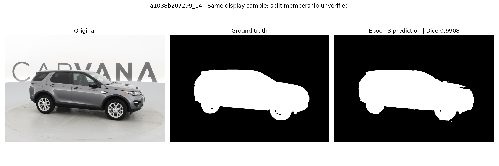

# U-Net Reproduction on Carvana

After reading [U-Net: Convolutional Networks for Biomedical Image Segmentation](https://arxiv.org/abs/1505.04597),
I wanted to understand how an image becomes a pixel-level segmentation mask.
I used [milesial/Pytorch-UNet](https://github.com/milesial/Pytorch-UNet) to run a
small Carvana reproduction and practice Python, PyTorch, and experiment recording.
Since my MacBook has no NVIDIA GPU, I rented an AutoDL RTX 3080 Ti for training.

The [project report](reports/REPRODUCTION_REPORT.md) describes why I chose the
project, what happened during training, and what I learned. The
[experiment details](reports/EXPERIMENT_DETAILS.md) preserve the technical records.

## Results

| Item | Observed result |
| --- | --- |
| Official source | `21d7850f2af30a9695bbeea75f3136aa538cfc4a`; captured tracked-source diff is empty |
| Data | 5,088 official Carvana training image/mask pairs |
| Training / validation | 4,580 / 508 images, upstream image-level split |
| Successful run | 5 epochs, batch size 1, scale 0.5, FP32 |
| Final internal foreground Dice (epoch 5) | **0.968135** |
| Highest epoch-end validation Dice among saved checkpoints | **0.981803 (epoch 3)** |
| Highest logged validation Dice | 0.990044; intermediate weights were not saved |
| Process duration | **1 h 7 min 39 s**, including initialization and log shutdown |
| Saved models | Five finite checkpoints; final model reloaded and used for prediction |


The initial AMP attempt produced NaN loss and non-finite checkpoint tensors.
A fresh FP32 run completed successfully without changing upstream source.

The report includes the failed AMP attempt, successful FP32 run, results,
prediction errors, and limitations of this first reproduction.

## Dataset

The training data is available from the
[Carvana Image Masking Challenge on Kaggle](https://www.kaggle.com/c/carvana-image-masking-challenge).
Sign in and accept the competition rules if requested. Only these two archives
are needed for this reproduction:

| File | Purpose | Extracted location in the official repository |
| --- | --- | --- |
| `train_hq.zip` | 5,088 high-quality RGB car images used as model inputs | `data/imgs/` |
| `train_masks.zip` | 5,088 reference masks identifying car and background pixels | `data/masks/` |

An image such as `a1038b207299_14.jpg` pairs with
`a1038b207299_14_mask.gif`. Put the extracted files directly in these folders.
The original training code splits these pairs into training and validation sets.
`train_masks.csv.zip`, `test.zip`, and `test_hq.zip` are not needed for this run.
Download the archives on the cloud training instance, or upload them there after
downloading through the Kaggle website.

## Reproduction workflow

1. Clone the official source and select the recorded commit.
2. Verify cloud Python, PyTorch/torchvision, CUDA access, and upstream dependencies.
3. Obtain official Kaggle `train_hq.zip` and `train_masks.zip`; verify archives and pairs.
4. Run the original training entry, recording commands, environment, logs, and weights.
5. Reload the final checkpoint with the original predictor and inspect the output.
6. Export metrics/figures and verify the downloaded backup before cloud shutdown.

The Mac is the editor/client; training executes on the Linux cloud GPU.
The community image supplies the runtime only; its code, subset, and old weights
are excluded. Local Docker is unnecessary.

The successful command, in the official checkout with prepared data, was:

```bash
export WANDB_MODE=offline
python -u train.py --epochs 5 --batch-size 1 --learning-rate 1e-5 --scale 0.5 --validation 10
```

## Files and evidence

| Path | Contents |
| --- | --- |
| `reports/` | Completed English report and selected figures |
| `records/carvana-baseline-02-fp32/` | Exported metrics, timestamps, source/dependency records, and checksums |
| `records/carvana-baseline-01/` | Failure notes and diagnostic results |
| `docs/` | Recorded training environment |
| `Pytorch-UNet/` | Separate official checkout, ignored by the outer repository |
| `artifacts/` | Verified local backup including raw logs, W&B files, and weights; ignored |
| `notes/` | Private learning notes; ignored |

The [artifact checklist](records/README.md) describes the evidence collected.
The raw package freeze includes container-specific paths and is not a portable
installation lockfile. Actual train/validation IDs were not saved; a fixed split
seed alone cannot recover membership across directory enumerations. The displayed
sample is not established as held-out data. No independent test score is claimed.

The official implementation retains its GPL-3.0 license in the separate checkout.
This repository contributes reproduction documentation and experiment records.
Public documents are in English. Raw data and large weights stay outside Git.
The AutoDL instance was observed shut down before the local inference comparison.

## Download the trained model

The selected epoch-3 weights are available in the
[v1.0.0 release](https://github.com/tommie-04/U-net/releases/tag/v1.0.0):

- [checkpoint_epoch3.pth](https://github.com/tommie-04/U-net/releases/download/v1.0.0/checkpoint_epoch3.pth) — approximately 118.5 MiB.
- [SHA256 checksum](https://github.com/tommie-04/U-net/releases/download/v1.0.0/checkpoint_epoch3.pth.sha256).

From the official `Pytorch-UNet` repository directory, download and verify it:

```bash
mkdir -p checkpoints
curl --fail --location \
  https://github.com/tommie-04/U-net/releases/download/v1.0.0/checkpoint_epoch3.pth \
  --output checkpoints/checkpoint_epoch3.pth
curl --fail --location \
  https://github.com/tommie-04/U-net/releases/download/v1.0.0/checkpoint_epoch3.pth.sha256 \
  --output checkpoints/checkpoint_epoch3.pth.sha256
(cd checkpoints && shasum -a 256 -c checkpoint_epoch3.pth.sha256)
```

The checkpoint uses three input channels, two classes, transposed convolution
upsampling (`bilinear=False`), and mask values `[0, 1]`. It contains model state,
not a complete training-resume snapshot. Use scale 0.5 for the prediction example
below. The cloud training environment is documented in the report.

## Try a single image

After training, run the following from the official `Pytorch-UNet` repository
directory, using the prepared Python environment. It loads epoch 3, selected by the highest logged epoch-end validation Dice,
and predicts a mask for one image:

```bash
mkdir -p predictions
python predict.py \
  --model checkpoints/checkpoint_epoch3.pth \
  --input data/imgs/a1038b207299_14.jpg \
  --output predictions/a1038b207299_14_pred.png \
  --scale 0.5
```

The weights are distributed as a release attachment rather than tracked in Git.
The dataset must be obtained from Kaggle separately. You can also use the
checkpoint produced by your own training run.
To try another RGB image, replace the input and output paths. A reference mask
is not needed for prediction; it is needed to compare against the correct
segmentation.

### Prediction comparison

The figure below uses **epoch 3**, which had the highest logged epoch-end
validation Dice among the five saved checkpoints (0.981803). Epoch 5 is the last
checkpoint, but it is not automatically the best one. The original display image
was retained for this comparison.



White marks the car and black marks the background. On this same image, Dice at
the original resolution was **0.9908 for epoch 3**, compared with **0.9337 for
epoch 5**. Epoch 3 removes most of the extra background seen in the earlier
prediction, although small boundary errors remain. These are single-image
scores, not the resized-resolution validation averages in the results table.

The image's actual training/validation membership was not recorded. This is a
qualitative example, not an independent test result. See the
[same-image comparison of both checkpoints](reports/figures/original_sample_epoch_comparison.png)
and [comparison notes](reports/CHECKPOINT_COMPARISON.md) for the sampling method,
local inference environment, and all sample scores. The
[earlier epoch-5 figure](reports/figures/prediction_comparison.png) is retained.
