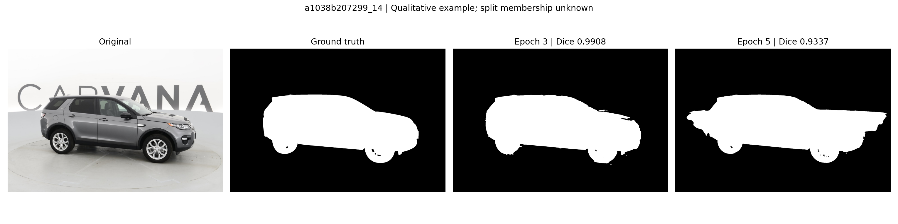

# Comparing the Saved Epoch-3 and Epoch-5 Models

## Why epoch 3 was selected

The original training script saved one model at the end of each epoch. Of those
five saved points, epoch 3 had the highest logged internal validation Dice:
0.981803, compared with 0.968135 at epoch 5. The choice of epoch 3 is based on
that existing record, not on a new training run. The highest intermediate
validation score, 0.990044, was not saved as a separate model.

The README keeps the same display image, `a1038b207299_14`, and now shows the
epoch-3 prediction. Its original-resolution Dice was **0.990765** for epoch 3
and **0.933728** for epoch 5. The earlier epoch-5 figure remains available.
The predictions were produced by the saved models with the official inference
function; neither binary mask was retouched.



## Fixed sample comparison

Before inference, the sample list was defined as the original display image
plus angle `01` of eight car IDs spaced evenly through the sorted car-ID list.
The table includes every evaluated sample. Some images score higher with epoch
5, so epoch 3 should not be described as better on every image.

| Image ID | Epoch 3 Dice | Epoch 5 Dice |
| --- | --- | --- |
| `a1038b207299_14` | 0.990765 | 0.933728 |
| `00087a6bd4dc_01` | 0.994340 | 0.992397 |
| `26ccab021981_01` | 0.977790 | 0.982833 |
| `40851e617b93_01` | 0.981918 | 0.995367 |
| `683ddec95b82_01` | 0.981169 | 0.961999 |
| `880fec285c06_01` | 0.985612 | 0.995196 |
| `bb2f95262773_01` | 0.992804 | 0.993589 |
| `dc995bf5296a_01` | 0.992324 | 0.994994 |
| `fff9b3a5373f_01` | 0.992583 | 0.993421 |
| **Mean of these nine images** | **0.987700** | **0.982614** |

These scores use binary car masks at the original image resolution after the
upstream predictor resizes logits. Training-time validation used resized masks.
They are different measurements and should not be substituted for one another.
The actual training/validation membership of these images was not recorded.
This comparison is descriptive, not an independent test set or a new validation
of the whole dataset. No average here is presented as a competition score.

The script also creates an auxiliary `selected_example.png` using the highest
epoch-3 Dice within this sample set. That post-selection is explicit in its
metadata; the auxiliary image is not used as the README's main example.

## Local inference and checks

The AutoDL instance was observed shut down before testing and was not restarted.
Inference ran in FP32 on the Mac CPU using Python 3.12.14, PyTorch 2.2.2,
torchvision 0.17.2, NumPy 1.26.4, Pillow 10.4.0, Matplotlib 3.8.4, and tqdm 4.64.1.
These are local inference versions, not changes to the recorded cloud training
environment. The official source, scale 0.5, two classes, and transposed
convolution configuration were retained.

The newly downloaded `train_hq.zip` matched the recorded training-archive
SHA256. Both checkpoints matched the backup manifest. For the original display
image, local CPU and previous cloud GPU epoch-5 masks agreed on
**99.999674% of pixels**, supporting consistency of the comparison despite the
runtime difference. This one-image check does not establish identical numerical
results for all images.

## Repeat the comparison

Use the separate official checkout and original data; they are not bundled in
this documentation repository. The script reads images directly from the ZIP
and uses extracted original GIF masks. It does not train or alter the models.
Run from the outer project folder, replacing the data locations as needed:

```bash
python -m venv .venv
source .venv/bin/activate
python -m pip install -r scripts/requirements-inference.txt
python scripts/compare_checkpoints.py \
  --image-zip /path/to/train_hq.zip \
  --mask-dir /path/to/train_masks \
  --checkpoint-dir /path/to/checkpoints \
  --output-dir artifacts/new-checkpoint-comparison
```

The output directory must be new. The [comparison script](../scripts/compare_checkpoints.py)
reuses upstream `predict_img` and saves per-image CSV scores, binary predictions,
comparison figures, model hashes, and inference metadata. The
[published CSV](../records/checkpoint-comparison/sample_scores.csv) and
[summary](../records/checkpoint-comparison/comparison_summary.json) contain the
measurements from this run. Large inputs and weights remain outside Git.
